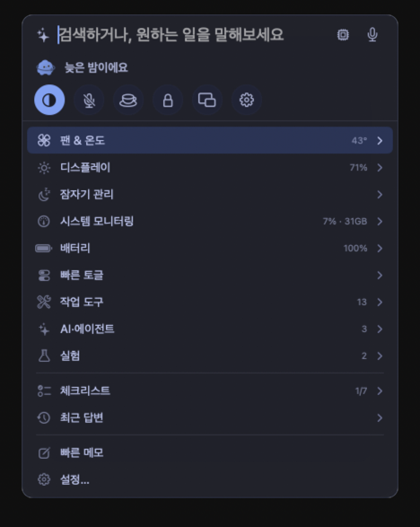
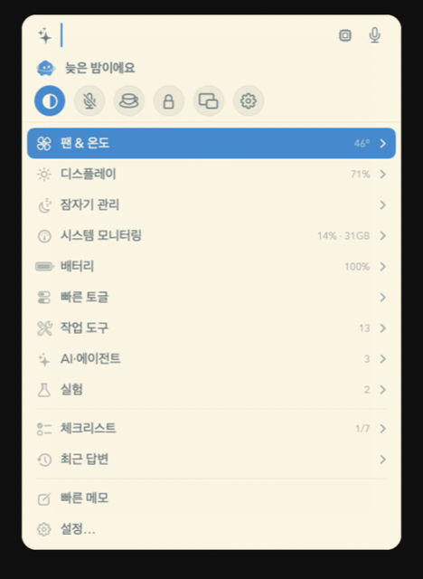
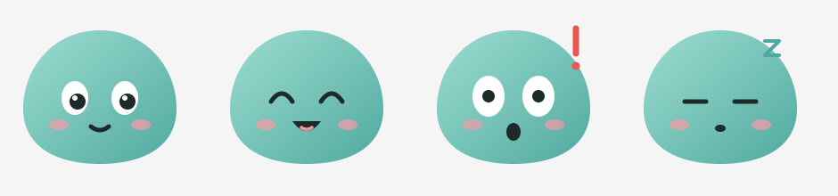

[English](README.md) · **한국어**

# Divee 플러그인

macOS 메뉴바 도우미 [Divee](https://github.com/dorkman43/divee) 용 테마·마스코트·플러그인 모음입니다.

**코딩을 몰라도 됩니다.** 종류마다 **AI 지침서**가 있어요. AI 채팅(Claude, ChatGPT, Gemini 등)에 붙여 넣고 원하는 걸 말하면, AI 가 바로 설치할 수 있는 폴더를 만들어 줍니다.

> 플러그인은 **Divee 1.0.8 이상**에서 쓸 수 있어요 — [Divee 받기](https://github.com/dorkman43/divee/releases/latest/download/Divee.dmg) (설정 › 플러그인). 집 안 기기 접속(`localNetwork`)은 **1.0.9 이상**이 필요해요.

| 종류 | 폴더 | AI 지침서 | 상태 |
|---|---|---|---|
| 🎨 테마 — 색·글꼴·글자 크기·모서리·간격 | [`themes/`](themes) | [AI-GUIDE-theme.md](guides/AI-GUIDE-theme.md) | ✅ 열림 |
| 🐾 마스코트 — 메뉴바 캐릭터 바꾸기 | [`mascots/`](mascots) | [AI-GUIDE-mascot.md](guides/AI-GUIDE-mascot.md) | ✅ 열림 |
| 🧩 플러그인 — 새 명령·카드(JavaScript) | [`plugins/`](plugins) | [AI-GUIDE-plugin.md](guides/AI-GUIDE-plugin.md) | ✅ 열림 |

## 테마

| Tokyo Night | Solarized Light |
|---|---|
|  |  |
| 색만 바꾼 예제 | 색 + 글꼴(Avenir Next)·글자 110%·둥근 모서리·여유 간격 |

## 마스코트

**말랑이** — SVG 그림 네 장과 PNG 한 장으로 만든 예제예요. 통통 튀기, 맥이 뜨거울 때 빨개지며 김 나기, 배터리 부족일 때 옅어지기는 Divee 가 알아서 붙여요. 팩에는 그림만 있으면 돼요.

만들기: [guides/AI-GUIDE-mascot.md](guides/AI-GUIDE-mascot.md) 를 AI 채팅에 붙여 넣고 캐릭터를 설명하세요(*"졸린 주황색 고양이"*, *"하얀 털복숭이에 빨간 목줄을 한 우리 강아지"*). 테마와 같은 방법으로 설치하고 설정 › 일반 › **마스코트**에서 고르세요.

## 플러그인

플러그인은 JavaScript 로 Divee 즉석 입력창에 명령과 카드를 더해요. 공식 플러그인 둘은 Divee 안에 이미 들어 있고, 읽고 고쳐 쓰라고 여기에도 두었어요.

- **환율 (`divee.currency`)** — `100달러`, `5만원 달러로`, `엔화 환율` 처럼 치면 유럽중앙은행 기준으로 바꾼 값을 카드로 보여 줘요. 권한: `api.frankfurter.dev` 로만 네트워크.
- **특수문자 (`divee.symbols`)** — □ ● → ※ 같은 기호를 패널에 칩으로 두고 클릭하면 복사해요. 권한 없음.

**플러그인은 코드**라서 설치할 때 필요한 권한(접속할 주소·클립보드·알림·AI 도구)을 Divee 가 물어요. 동의하기 전에 목록을 읽어 보세요. 테마·마스코트는 묻지 않아요.

만들기: [guides/AI-GUIDE-plugin.md](guides/AI-GUIDE-plugin.md) 를 AI 채팅에 붙여 넣고 원하는 걸 말하세요(*"'3마일' 을 km 로 바꿔 주는 카드"*). 공식 플러그인을 고치려면 폴더를 받아 고친 뒤 **폴더에서 설치…** 하세요 — 같은 id 면 내 것이 내장보다 우선해요.

## AI 로 내 테마 만들기

1. [guides/AI-GUIDE-theme.md](guides/AI-GUIDE-theme.md) 를 열어 전체를 복사해 AI 채팅에 붙여 넣으세요.
2. 원하는 걸 말하세요. 예: *"Dracula 같은 Divee 테마 만들어줘"*, *"따뜻한 베이지색, 글자 크게, 모서리 둥글게"*
3. AI 가 `manifest.json` 과 `theme.json` 두 파일을 줍니다. `id` 와 똑같은 이름의 폴더를 만들어 그 안에 저장하세요.
4. 아래처럼 설치하고, Divee › 설정 › 일반 › **테마**에서 고르세요.

문제가 있으면 Divee › 설정 › **플러그인**에 쉬운 말로 떠요. **AI에게 고쳐 달라기 복사**를 눌러 같은 AI 채팅에 붙여 넣으면 고쳐 줍니다.

살짝만 바꾸고 싶다면 Divee › 설정 › 일반 › 테마 › **내 맞춤**에서 파일 없이 글꼴·글자 크기·모서리·간격·배경 불투명도·테두리를 바꿀 수 있어요.

## 설치

1. 이 저장소를 내려받거나(**Code › Download ZIP**) 원하는 폴더만 받으세요.
2. Divee › 설정 › **플러그인** › **폴더에서 설치…** → 폴더(예: `themes/dorkman.tokyo-night`, `mascots/dorkman.blob`, `plugins/divee.symbols`)를 고르세요.
3. 설정 › 일반 › **테마**(또는 **마스코트**)에서 고르세요.

테마와 마스코트는 데이터일 뿐이라 코드를 실행하거나 권한을 요청할 수 없어요. 플러그인은 코드를 실행해서 이 단계에서 권한을 물어요.

## 내 테마 올리기

Pull request 를 환영해요 — [CONTRIBUTING.md](CONTRIBUTING.md) 를 봐 주세요. `themes/`, `mascots/`, `plugins/` 아래에 폴더를 넣고 [`index.json`](index.json) 에 한 줄 추가하면 됩니다.

## 라이선스

[MIT](LICENSE) — 각 작품의 저작권은 `manifest.json` 에 적힌 작성자에게 있어요.
